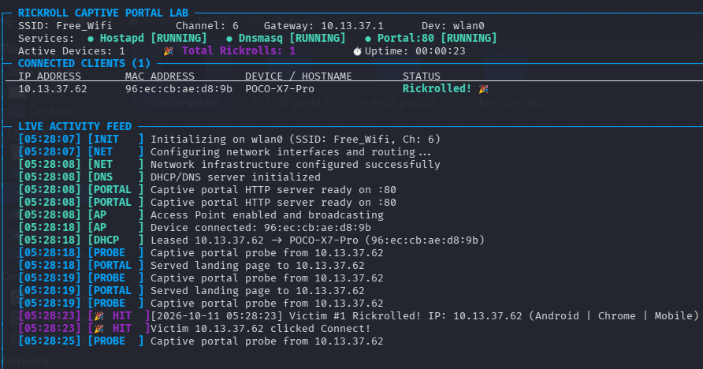
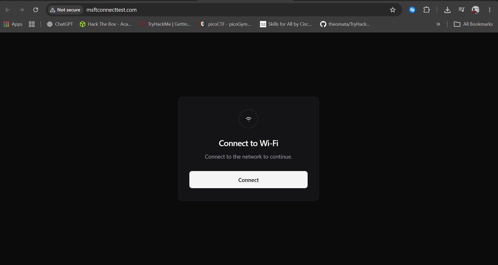

# 🎵 Rickroll Captive Portal

A turnkey Rogue Access Point & Captive Portal prank system for Linux. When users connect to the open Wi-Fi network, their device automatically detects a captive portal. Clicking **Connect** reveals a fullscreen animated Rickroll with looping audio.

Features a unified **TUI Console Dashboard** (Bettercap-style live terminal UI), zero external Python dependencies, and instant captive detection.

---

## 📸 Previews

### 🖥️ TUI Console Dashboard
<p align="center">
  
</p>

### 📱 Victim's Captive Portal Screen
<p align="center">
  
</p>

---

## ⚡ How It Works

```text
[ Client Device ]
       │  Connects to SSID (e.g. "Free_Wifi")
       ▼
 [ hostapd (wlan0) ]
       │  DHCP lease + RFC 8910 Option 114 (Immediate Captive Discovery)
       ▼
 [ dnsmasq (10.13.37.1) ]
       │  DNS Spoofing resolves all domain queries to 10.13.37.1
       ▼
 [ portal.py (Port 80) ]
       │  Captive portal probes (/generate_204, /hotspot-detect.html, etc.) -> 302 -> "/"
       ▼
 [ Web Portal UI ] ─── User clicks "Connect" ───► [ Fullscreen Rickroll ]
                                                  (rickroll.gif + overlay.png + audio)
```

---

## 🛠️ Hardware & Prerequisites

- **Operating System:** Linux (Kali Linux, Ubuntu, Debian, Raspberry Pi OS).
- **Wireless Adapter:** A USB or internal Wi-Fi adapter with **Access Point (AP) mode** support (`nl80211` driver, e.g., Atheros AR9271, RT5370, MT7601U, RTL8812AU).
- **Root / Sudo Privileges:** Required for managing network interfaces, iptables, and port 80.

---

## 📦 Installation

1. **Clone the repository:**
   ```bash
   git clone https://github.com/theomata/rickroll-captiveportal.git
   cd rickroll-captiveportal
   ```

2. **Make all scripts executable:**
   ```bash
   chmod +x *.sh dashboard.py
   ```

3. **Install required system packages:**
   ```bash
   sudo apt update && sudo apt install -y hostapd dnsmasq python3 iptables iw tmux
   ```

---

## 🚀 Usage

### 1. Default Launch (Interactive TUI Dashboard)
```bash
./start.sh
```
*or directly:*
```bash
sudo python3 dashboard.py
```

This automatically:
- Checks all system dependencies and root access.
- Assigns `10.13.37.1/24` to `wlan0`.
- Configures Port 443 fast TCP reset (prevents mobile TLS timeouts).
- Configures wildcard DNS spoofing & RFC 8910 Option 114 for instant captive detection.
- Launches the unified interactive **TUI Dashboard** monitoring all services, active clients, and live hits.

### 2. Custom SSID, Channel & Interface
You can customize network parameters on the fly via CLI flags:
```bash
# Custom network name & channel
./start.sh --ssid "Starbucks_Guest" --channel 1

# Specify a different wireless interface
./start.sh --interface wlan1 --ssid "Airport_Free_WiFi"

# Optional: Launch in classic 3-pane tmux mode instead of TUI
./start.sh --tmux
```

### 3. Teardown / Stop
- Inside the TUI dashboard, simply press **`q`** or **`Ctrl + C`** — all background services and iptables rules are automatically restored.
- If running headless or in tmux, you can run:
  ```bash
  ./kill.sh
  ```

### 4. Adapter Reset (VM Stability)
If using a VM USB Wi-Fi adapter that gets stuck in an unstable driver state:
```bash
sudo ./adapter.sh
```

---

## 🎮 TUI Dashboard Controls

| Key | Action |
| :--- | :--- |
| **`q`** or **`ESC`** | Gracefully stop all services, flush iptables rules, and exit |
| **`c`** | Clear activity feed |
| **`↑` / `↓`** | Scroll through live activity log history |

---

## ⚙️ Customization

| Setting | Location | Description |
| :--- | :--- | :--- |
| **Wi-Fi SSID** | `--ssid <name>` or `hostapd.conf` | Network broadcast name (e.g. `Free_Wifi`) |
| **Wi-Fi Channel** | `--channel <num>` or `hostapd.conf` | 2.4GHz Channel (1, 6, or 11 recommended) |
| **DHCP Subnet** | `dnsmasq.conf` & `setup-network.sh` | Default is `10.13.37.0/24` |
| **Overlay Graphic** | `overlay.png` | Replace with any transparent PNG graphic |
| **Audio Track** | `rickroll.mp3` | Replace with any MP3 audio file |
| **Background GIF** | `rickroll.gif` | Replace with any animated GIF |

---

## 🔍 Troubleshooting

- **Wi-Fi interface is not named `wlan0`:**
  Check your interface name with `ip link` or `iw dev`, then run:
  ```bash
  ./start.sh --interface wlan1
  ```

- **Wi-Fi is blocked by rfkill:**
  ```bash
  sudo rfkill unblock all
  ```

- **NetworkManager keeps interfering with the AP:**
  Set the interface to unmanaged:
  ```bash
  sudo nmcli device set wlan0 managed no
  ```

---

## ⚖️ Disclaimer

This tool is strictly intended for educational demonstrations, authorized lab environments, and harmless pranks. Always obtain authorization before broadcasting wireless access points in shared or institutional environments.
